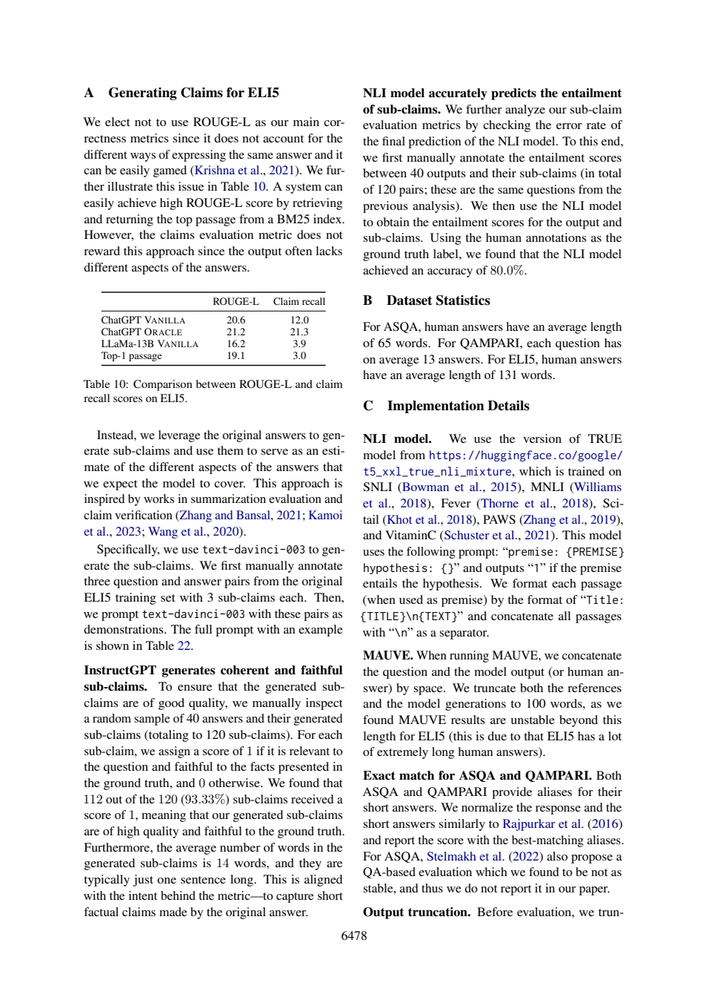

# MAUVE的100词截断，究竟截了什么

同一论文的“100词”和“换行截断”属于不同处理层。把它们读错会直接改变送入评价器的字符串。本文给出核对后的科学答案、一次基础提示和一次核查提示的真实新调用，以及无需联网的教学检查。不是原论文实验复现。

## 两种截断必须分开

ALCE的100词规则是MAUVE评估预处理，不能当成生成上限，更不能推成所有指标都只读100词。§3.1物理3（6467）只在ASQA、ELI5使用MAUVE；QAMPARI返回短答案列表，作者在实验中观察格式遵守稳定，因此省略。MAUVE对长度、风格敏感，作者把它主要作为足够高时的sanity check，没有定义可通用的“足够高”阈值。

附录C物理14（6478）说，计算MAUVE时将question和model output或human answer以空格拼接，并把references与generations都截到100 words，因ELI5长人工答案造成超过此长度时不稳定。这里的references是参考答案，不是参考文献表，也不是检索到的100-word passages。只靠这些话不能唯一决定词计数器、精确截断顺序和多参考处理；本例没有查看作者实现，因此保留实现缺口。

物理14最后一行的Output truncation接到物理15（6479）开头：在评价前按换行截断模型输出，动机是非指令模型可能换行后继续无关内容。这是另一规则。核查时要保留跨页句子，不能把100-word语料分块、100-word MAUVE输入裁剪、按换行清理输出这三个步骤合为一件事。

|操作|对象与目的|本例能否确定实现|
|---|---|---|
|100-word passage|检索语料粒度，便于验证/放入上下文|与MAUVE上限不同|
|MAUVE裁剪|参考与生成的评估输入，稳定长度|文字描述有，代码细节未核|
|换行截断|评价前模型输出清理|有跨页说明，不是采样停止参数|

离线算例用98词问题与10词答案比较两种显式假设：先拼接再取100词只留下2词答案；先对答案取100词再拼接保留10词答案、总108词。另展示第一行截断。这是**歧义的教学反例**，不声称任何一种等于作者代码，也不计算MAUVE。实际复现应固定作者代码commit、环境和MAUVE参数，再验证中间字符串；本次只完成论文阅读与教学计算。

## 两组原答与具体修正

baseline D1正确识别数据集与sanity check；D2把references译成“参考文献”，应改参考答案，虽然它随后讨论多reference，仍会误导输入对象。D3区分两种预处理，D4给重复、敏感性建议，但这是未执行的后续计划。workflow保留了两种截断，也补充词计数和处理顺序缺口；D2称“文中未列出实现脚本”需要限定为本次页未提供，不能声称作者没发布代码。

两组source_id均不在输入允许集合：baseline加SOURCE前缀，workflow还加physical page后缀；机械定位都失败。workflow D4设计50/100/150词敏感性实验是建议，并未实际跑。本轮不会把建议当实测改进；正确答案与离线示例另行提供，原模型响应不修改。




## 方法为什么这样设计

先为D1–D4写[任务](18-task.txt)与不发给模型的[标准](18-criteria.md)，核对必要页，再以[冻结哈希](18-protocol-lock.json)锁定六个文件。baseline只收任务与编号原文；workflow增加[通用核查流程](18-workflow.txt)，其余材料、问题、JSON要求、模型权限、180秒超时相同。按[协议](18-protocol.md)固定先baseline后workflow，不挑样本、不删失败。行号使每个断言可回查，但验证器只判断范围，不判断蕴含、单位或跨页限定，所以正文另作非盲语义审计。

两组没有给方法组额外gold或证据，criteria均不发送。但处理提示更长、运行顺序未随机化、服务snapshot/seed/temperature不可锁定，且每组只有一次，因此不报告统计显著、稳定增益或费用优势。本次看到了共享的定位故障，不能包装成方法胜利。

|条件|实际模型|墙钟秒（含预检）|输入token|输出token|机械检查|
|---|---|---:|---:|---:|---|
|baseline|chenkun/gpt-5-mini|28.2|4187|3552|range_errors|
|workflow|chenkun/gpt-5-mini|32.707|4317|4251|range_errors|

原始completion ID、模型与usage见各metadata。工具Bohrium原生CLI2.8.1，gpt-5-mini请求、photon；实际模型如表。服务没有逐次货币扣费，cost=null，不等于免费。全部10个调用中本篇仅包含自己的两次记录；其它题不进入本材料包。

## 复做：先离线检查，再选是否调用模型

下载本目录的文件，Python3标准库即可。文件前缀仅为同一仓库隔离五份作品；冻结锁中的原始文件名应加前缀`18-`后查找，其字节未改。

```sh
python 18-worked-example.py
python 18-validate.py 18-sources.json 18-baseline-output.json
python 18-validate.py 18-sources.json 18-workflow-output.json
```

离线算例预期逐字段等于[保存结果](18-worked-example-result.json)，是教学计算，不是新GPU/NLI/问答实验。验证器ranges_valid退出0、range_errors或invalid_json退出1；本次状态如上表，失败是预期保存事实而非安装故障。机械通过仍需逐项对照[编号原文](18-numbered.txt)与正文核查。

重新阅读需自行从玻尔官方渠道安装对应系统原生CLI、登录并确认额度；在保持原件不变的新目录运行：

```sh
python 18-replay.py --bohr /absolute/path/to/bohr --condition baseline --out fresh-baseline
python 18-replay.py --bohr /absolute/path/to/bohr --condition workflow --out fresh-workflow
```

脚本先dry-run逐字核对message，真实调用保留请求/原答/响应/usage/stderr，不覆盖已有out。非语义UUID不同，结果不保证相同。Windows用原生exe避免.cmd多行截断，命令行不得超系统长度；只从子进程移除代理变量，不改系统配置。source_id失败应先被拒绝，不能静默把整段标题映射回ID冒充原答成功。

后续拟修复方式：提示显式列出允许ID并提供字段示例，要求只输出ID值；解析器拒绝标题、页码后缀和未知ID。此方式**本篇尚未追加调用验证**；保存workflow保持原样，以便别人复核本次实际失败。

## 文件导航

核心输入为[task](18-task.txt)、[workflow](18-workflow.txt)、[sources](18-sources.json)、[编号文本](18-numbered.txt)，[协议](18-protocol.md)与[验收标准](18-criteria.md)先于调用冻结。baseline/workflow各自的-request.txt是实际message，-preflight.json保存dry-run，-response.json为余额脱敏后的完整响应，-output.json为原答，-metadata.json为模型与usage，-stderr.txt保留stderr，-validation.json为严格定位结果。正文核查与原答分开，无静默修答案。

来源版本、许可与个人贡献见[SOURCES](18-SOURCES.md)。读者若仅核查关键结论，无需运行模型；材料离线齐全。Codex协助设计、运行和非盲审计；没有新的人类独立评审、原论文训练或部署收益测量。
