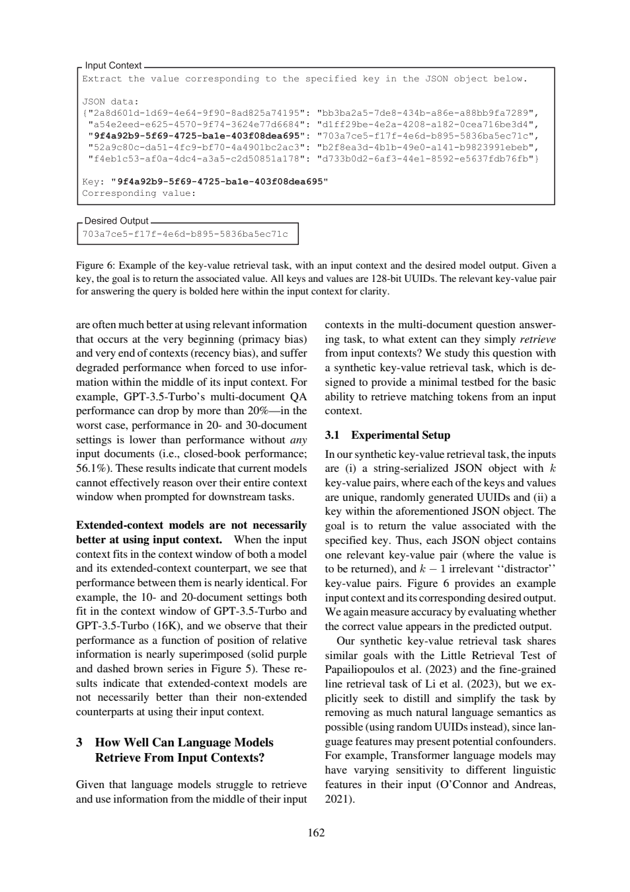

# UUID检索答对了，为什么仍不等于严格JSON成功

论文的命中率高，不代表返回值能直接交给JSON解析器。本例把论文判分和工程输出契约放在同一组反例里。本文给出核对后的科学答案、一次基础提示和一次核查提示的真实新调用，以及无需联网的教学检查。不是原论文实验复现。

## 检索命中与可直接消费的输出，是两份契约

《Lost in the Middle》§3.1物理6（印刷162）把合成输入定义为序列化JSON对象与其中一个key：k个键值对，keys和values为随机唯一128-bit UUID，一个相关对、k−1个干扰对，目标返回对应value。随机UUID用来尽量移除自然语言语义混淆，不证明所有非语义因素消失；128-bit也不是128字符。

§3.2物理7（163）设置k=75/140/300，每种500例；相关key在对象中的位置控制位置，增加干扰对控制长度。这不是多文档QA里文档数量或自然语言语义实验。原文计accuracy的判据是“正确value出现在预测输出”。因此正确值加解释可能命中；只给未包含目标值的检索代码不满足；代码里恰好含目标值则按文字判据可能命中，不能把“代码”本身当统一失败条件。精确归一化细节仍需作者代码确认。

|教学输出|value出现|严格裸字符串等于value|严格JSON对象契约|
|---|---|---|---|
|只给value|是|是|否|
|解释加value|是|否|否|
|JSON对象含value及额外字段|是|否|否|
|只有检索代码、不含目标value|否|否|否|
|只含一个value字段的JSON对象|是|否|是|

离线算例使用固定UUID、显式定义的substring/equality/JSON-key规则，输出三列真实运行结果。它是接口契约反例，**没有调用论文模型或重跑75/140/300任务**，也不声称完全复制论文字符串标准化。使用者如果要把输出直接送下游程序，就必须另外验JSON与字段，不能拿论文retrieval accuracy替代。

原文Claude-1.3与100K版在所评估长度近乎完美；不是所有模型都必然中间失败。LongChat-13B(16K)在140对、相关信息置于开头时，作者定性观察到倾向生成代码；这是具体行为观察，不是已隔离的唯一错误原因。合成精确匹配的高分不保证真实多跳文献理解。

## 本次两组核查

两组D1/D2正确恢复任务与样本数，D3能区分包含值和纯代码，D4保留模型与位置边界。workflow D1把“旨在减少语义线索”说成“排除语义线索、等价于精确匹配”，仍要收窄为设计动机；随机UUID的tokenization与模型行为并未被排除。

baseline D3 B-P6:55–56准确覆盖计分描述；D2 B-P7:15–16只到“500 examples”，缺第17行each，语义核查应连读15–19确认每种500。workflow全部source_id带整段标题，程序拒绝定位。科学解释大体保留，却退化为不可按ID直接消费的结果，正好说明阅读解释和结构契约应分开验收。




## 方法为什么这样设计

先为D1–D4写[任务](19-task.txt)与不发给模型的[标准](19-criteria.md)，核对必要页，再以[冻结哈希](19-protocol-lock.json)锁定六个文件。baseline只收任务与编号原文；workflow增加[通用核查流程](19-workflow.txt)，其余材料、问题、JSON要求、模型权限、180秒超时相同。按[协议](19-protocol.md)固定先baseline后workflow，不挑样本、不删失败。行号使每个断言可回查，但验证器只判断范围，不判断蕴含、单位或跨页限定，所以正文另作非盲语义审计。

两组没有给方法组额外gold或证据，criteria均不发送。但处理提示更长、运行顺序未随机化、服务snapshot/seed/temperature不可锁定，且每组只有一次，因此不报告统计显著、稳定增益或费用优势。本次看到了共享的定位故障，不能包装成方法胜利。

|条件|实际模型|墙钟秒（含预检）|输入token|输出token|机械检查|
|---|---|---:|---:|---:|---|
|baseline|chenkun/gpt-5-mini|22.446|2057|2528|ranges_valid|
|workflow|chenkun/gpt-5-mini|25.943|2187|3381|range_errors|

原始completion ID、模型与usage见各metadata。工具Bohrium原生CLI2.8.1，gpt-5-mini请求、photon；实际模型如表。服务没有逐次货币扣费，cost=null，不等于免费。全部10个调用中本篇仅包含自己的两次记录；其它题不进入本材料包。

## 复做：先离线检查，再选是否调用模型

下载本目录的文件，Python3标准库即可。文件前缀仅为同一仓库隔离五份作品；冻结锁中的原始文件名应加前缀`19-`后查找，其字节未改。

```sh
python 19-worked-example.py
python 19-validate.py 19-sources.json 19-baseline-output.json
python 19-validate.py 19-sources.json 19-workflow-output.json
```

离线算例预期逐字段等于[保存结果](19-worked-example-result.json)，是教学计算，不是新GPU/NLI/问答实验。验证器ranges_valid退出0、range_errors或invalid_json退出1；本次状态如上表，失败是预期保存事实而非安装故障。机械通过仍需逐项对照[编号原文](19-numbered.txt)与正文核查。

重新阅读需自行从玻尔官方渠道安装对应系统原生CLI、登录并确认额度；在保持原件不变的新目录运行：

```sh
python 19-replay.py --bohr /absolute/path/to/bohr --condition baseline --out fresh-baseline
python 19-replay.py --bohr /absolute/path/to/bohr --condition workflow --out fresh-workflow
```

脚本先dry-run逐字核对message，真实调用保留请求/原答/响应/usage/stderr，不覆盖已有out。非语义UUID不同，结果不保证相同。Windows用原生exe避免.cmd多行截断，命令行不得超系统长度；只从子进程移除代理变量，不改系统配置。source_id失败应先被拒绝，不能静默把整段标题映射回ID冒充原答成功。

后续拟修复方式：提示显式列出允许ID并提供字段示例，要求只输出ID值；解析器拒绝标题、页码后缀和未知ID。此方式**本篇尚未追加调用验证**；保存workflow保持原样，以便别人复核本次实际失败。

## 文件导航

核心输入为[task](19-task.txt)、[workflow](19-workflow.txt)、[sources](19-sources.json)、[编号文本](19-numbered.txt)，[协议](19-protocol.md)与[验收标准](19-criteria.md)先于调用冻结。baseline/workflow各自的-request.txt是实际message，-preflight.json保存dry-run，-response.json为余额脱敏后的完整响应，-output.json为原答，-metadata.json为模型与usage，-stderr.txt保留stderr，-validation.json为严格定位结果。正文核查与原答分开，无静默修答案。

来源版本、许可与个人贡献见[SOURCES](19-SOURCES.md)。读者若仅核查关键结论，无需运行模型；材料离线齐全。Codex协助设计、运行和非盲审计；没有新的人类独立评审、原论文训练或部署收益测量。
