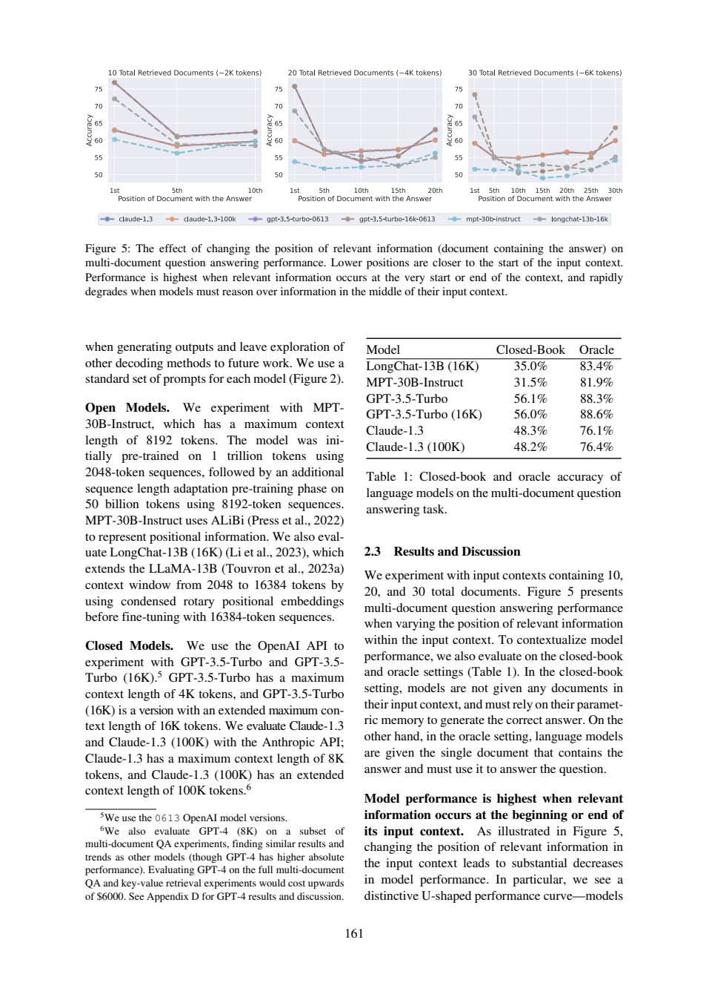

# 无文档到单篇Oracle：差值能算成检索收益吗

单篇含答案文档带来的大幅准确率差，很容易被包装成检索器收益。本例区分输入方案与真实检索链。本文给出核对后的科学答案、一次基础提示和一次核查提示的真实新调用，以及无需联网的教学检查。不是原论文实验复现。

## Oracle差值是诊断对比，不是已部署检索器的收益

《Lost in the Middle》Table1物理5（161）给closed-book和Oracle：前者不给文档，后者直接给单篇含答案文档。§2.1物理3（159）的受控多文档QA则放k篇，其中一篇含标注答案、其余是干扰。脚注提醒歧义可能使少量干扰文档也含合理答案，不能把标注保证说成所有可能答案的逻辑唯一性。

|模型|Closed-book %|单篇Oracle %|差值（百分点）|
|---|---:|---:|---:|
|LongChat-13B(16K)|35.0|83.4|48.4|
|MPT-30B-Instruct|31.5|81.9|50.4|
|GPT-3.5-Turbo|56.1|88.3|32.2|
|GPT-3.5-Turbo(16K)|56.0|88.6|32.6|
|Claude-1.3|48.3|76.1|27.8|
|Claude-1.3(100K)|48.2|76.4|28.2|

差值来自表中报告精度的算术。它比较“不给文档”和“直接给正确单篇”的输入方案，不是测真实retriever能否找到这篇，也没测它的排序、成本、延迟或带入的干扰。两组受控输入比较可以讨论该输入处理的效果；但不能把端到端误差分解为可相加的检索与阅读贡献，更不能当作所有系统的数学上界。额外材料、参数知识、任务变化都可能改变结果。

§2.3跨物理5–6（161–162）给了反例：GPT-3.5-Turbo在20/30文档的某些最坏位置，低于closed-book 56.1%。这是相关信息位于难用位置的条件观察；不能说任何文档、所有位置或所有模型都更差。原文“drop by more than20%”也不能自动改成相对closed-book下降超过20%；比较基准没有这样规定。

这里的Oracle是单篇输入设置，与其他论文同名的gold-aware候选选择不能互换。本次不需要借用ALCE的实现细节来完成定义；所供LIM页没有ALCE算法证据，因此不会假称模型已核对过另一论文。

离线代码用Decimal重算六个差值，并输出三个输入方案的区别。它验证读表算术与方案标签，**不是复跑问答、检索或统计显著性检验**。

## 两组原答核查

两组D2十二个表值与六差值正确，baseline B-P5:40–49足够覆盖表头、模型和说明。两组D1分开三种设置，但都未带歧义脚注边界。baseline D4泛说“某些设置”而漏掉明确20/30条件；workflow补出GPT-3.5、20/30和56.1，却把超过20%的下降连到closed-book，比较基准过度解释。workflow D1正确保留了B-P3的最多100 tokens（令牌）段落单位；不能与ALCE的100-word语料粒度混用。

baseline D3把Oracle称“上限样本”，应改诊断参考；两组都声明不是普遍上界，但说明理由时更需要强调没有数学保证，而不仅是真实检索不完美。workflow source_id含页码后缀，机械失败；原答不修。本轮有具体细节改善，也有单位、比较基准退步，不能宣称工作流整体胜出。




## 方法为什么这样设计

先为D1–D4写[任务](20-task.txt)与不发给模型的[标准](20-criteria.md)，核对必要页，再以[冻结哈希](20-protocol-lock.json)锁定六个文件。baseline只收任务与编号原文；workflow增加[通用核查流程](20-workflow.txt)，其余材料、问题、JSON要求、模型权限、180秒超时相同。按[协议](20-protocol.md)固定先baseline后workflow，不挑样本、不删失败。行号使每个断言可回查，但验证器只判断范围，不判断蕴含、单位或跨页限定，所以正文另作非盲语义审计。

两组没有给方法组额外gold或证据，criteria均不发送。但处理提示更长、运行顺序未随机化、服务snapshot/seed/temperature不可锁定，且每组只有一次，因此不报告统计显著、稳定增益或费用优势。本次看到了共享的定位故障，不能包装成方法胜利。

|条件|实际模型|墙钟秒（含预检）|输入token|输出token|机械检查|
|---|---|---:|---:|---:|---|
|baseline|chenkun/gpt-5-mini|22.645|3282|3005|ranges_valid|
|workflow|chenkun/gpt-5-mini|39.643|3412|5503|range_errors|

原始completion ID、模型与usage见各metadata。工具Bohrium原生CLI2.8.1，gpt-5-mini请求、photon；实际模型如表。服务没有逐次货币扣费，cost=null，不等于免费。全部10个调用中本篇仅包含自己的两次记录；其它题不进入本材料包。

## 复做：先离线检查，再选是否调用模型

下载本目录的文件，Python3标准库即可。文件前缀仅为同一仓库隔离五份作品；冻结锁中的原始文件名应加前缀`20-`后查找，其字节未改。

```sh
python 20-worked-example.py
python 20-validate.py 20-sources.json 20-baseline-output.json
python 20-validate.py 20-sources.json 20-workflow-output.json
```

离线算例预期逐字段等于[保存结果](20-worked-example-result.json)，是教学计算，不是新GPU/NLI/问答实验。验证器ranges_valid退出0、range_errors或invalid_json退出1；本次状态如上表，失败是预期保存事实而非安装故障。机械通过仍需逐项对照[编号原文](20-numbered.txt)与正文核查。

重新阅读需自行从玻尔官方渠道安装对应系统原生CLI、登录并确认额度；在保持原件不变的新目录运行：

```sh
python 20-replay.py --bohr /absolute/path/to/bohr --condition baseline --out fresh-baseline
python 20-replay.py --bohr /absolute/path/to/bohr --condition workflow --out fresh-workflow
```

脚本先dry-run逐字核对message，真实调用保留请求/原答/响应/usage/stderr，不覆盖已有out。非语义UUID不同，结果不保证相同。Windows用原生exe避免.cmd多行截断，命令行不得超系统长度；只从子进程移除代理变量，不改系统配置。source_id失败应先被拒绝，不能静默把整段标题映射回ID冒充原答成功。

后续拟修复方式：提示显式列出允许ID并提供字段示例，要求只输出ID值；解析器拒绝标题、页码后缀和未知ID。此方式**本篇尚未追加调用验证**；保存workflow保持原样，以便别人复核本次实际失败。

## 文件导航

核心输入为[task](20-task.txt)、[workflow](20-workflow.txt)、[sources](20-sources.json)、[编号文本](20-numbered.txt)，[协议](20-protocol.md)与[验收标准](20-criteria.md)先于调用冻结。baseline/workflow各自的-request.txt是实际message，-preflight.json保存dry-run，-response.json为余额脱敏后的完整响应，-output.json为原答，-metadata.json为模型与usage，-stderr.txt保留stderr，-validation.json为严格定位结果。正文核查与原答分开，无静默修答案。

来源版本、许可与个人贡献见[SOURCES](20-SOURCES.md)。读者若仅核查关键结论，无需运行模型；材料离线齐全。Codex协助设计、运行和非盲审计；没有新的人类独立评审、原论文训练或部署收益测量。
