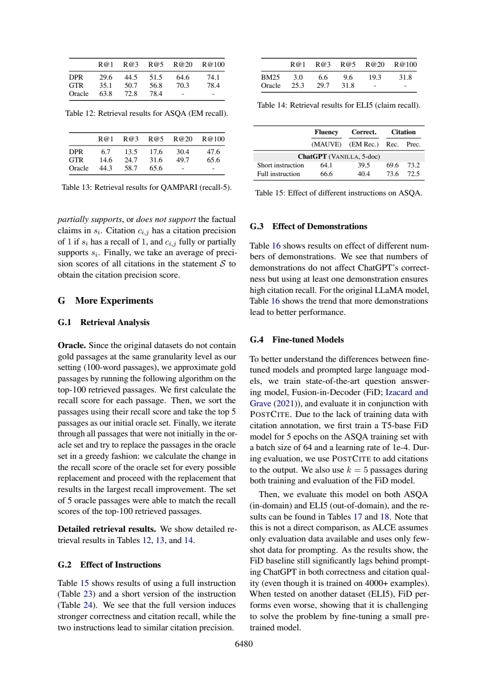

# 完整指令提高所有分数了吗：Table15的取舍

一份更完整的指令在三个维度均值提高，却在引用precision下降。读表需要先决定比较维度，不能只挑上升列。本文给出核对后的科学答案、一次基础提示和一次核查提示的真实新调用，以及无需联网的教学检查。不是原论文实验复现。

## 完整指令不是四项同时提高

ALCE Table15物理16（6480）设置为ASQA、ChatGPT VANILLA、5-doc。读全表头后Full减Short为MAUVE +2.5分、EM recall +0.9百分点、citation recall +4.0百分点、citation precision −0.7百分点。最后一项下降；作者说两者precision相近，不能把“相近”写成精确相等。

|指令|MAUVE（分）|EM recall %|Citation recall %|Citation precision %|
|---|---:|---:|---:|---:|
|Short|64.1|39.5|69.6|73.2|
|Full|66.6|40.4|73.6|72.5|
|Full减Short|+2.5分|+0.9百分点|+4.0百分点|−0.7百分点|

Tables23/24位于物理21（6485）。两者已有“只用提供的search results”和正确引用。Full进一步要求准确、吸引、简洁、无偏新闻式语气、每个事实主张引用、每句1至3篇、多篇支持时仅引最小充分子集。不能把共有的only provided results说成Full独有新增。这个实验一次改变了多个指令成分，不是保持语义完全一致只增加字数，也不是某一句约束的单因素消融，因此不能从Table15得出越长越好或一句话导致4.0百分点收益。

附录C物理15（6479）说明除RERANK外三seed、每次从四个示例抽两个，主文报告均值并指向G.6标准差。但Table15没有本表误差条，所供页也没有配对逐次结果；不等于从未重复，也不能假称G.6必然给了本表差值的全部方差。没有本表配对波动，不能仅凭均值判断统计显著。本文也未重跑该ASQA生成实验。

还有一个目标差别：Full要求minimum sufficient subset，而§3.3物理4–5（6468–6469）的评价器明确不要求最小集。它处罚irrelevant引用需要“自身不支持且移除后其余仍支持”，并以该句联合recall=1为precision=1前提。两条各自完整支持时不会仅因冗余被罚。提示偏好与计分规则不完全相同，不表示指标实现错了。

离线代码重算四项差值，执行Pareto支配检查：Full不是四项均不差，因为precision较低；Short也不支配Full。这是多指标取舍的教学检查，既不发明加权总分，也不推断显著性。

## 两组原答核查

两组D1均计算正确、单位明确，但没有在本项清楚写全ASQA/5-doc设置；workflow D1以算式给值而非完整两行，仍可还原但阅读入口不够清楚。baseline D2把“仅使用给定结果”放在新增清单后再说共有，表达冲突；workflow D2更清楚地区分已有与新增。两组D3拒绝长度/单句归因，D4识别最小集与评价器差异。

两组都将G.6标准差写得过确定，必须限定为作者一般指向，未核本表配对方差。workflow D1称EM recall/accuracy，也应避免把特定指标偷换成泛accuracy。baseline A-P21:44–53可核对两份指令，A-P16:47–52可核表；workflow全部source_id用整段标题而失效。本轮能支持“部分表达更清楚”，不能支持“自动核查链更可靠”。




## 方法为什么这样设计

先为D1–D4写[任务](21-task.txt)与不发给模型的[标准](21-criteria.md)，核对必要页，再以[冻结哈希](21-protocol-lock.json)锁定六个文件。baseline只收任务与编号原文；workflow增加[通用核查流程](21-workflow.txt)，其余材料、问题、JSON要求、模型权限、180秒超时相同。按[协议](21-protocol.md)固定先baseline后workflow，不挑样本、不删失败。行号使每个断言可回查，但验证器只判断范围，不判断蕴含、单位或跨页限定，所以正文另作非盲语义审计。

两组没有给方法组额外gold或证据，criteria均不发送。但处理提示更长、运行顺序未随机化、服务snapshot/seed/temperature不可锁定，且每组只有一次，因此不报告统计显著、稳定增益或费用优势。本次看到了共享的定位故障，不能包装成方法胜利。

|条件|实际模型|墙钟秒（含预检）|输入token|输出token|机械检查|
|---|---|---:|---:|---:|---|
|baseline|chenkun/gpt-5-mini|24.951|6731|3401|ranges_valid|
|workflow|chenkun/gpt-5-mini|37.725|6866|5261|range_errors|

原始completion ID、模型与usage见各metadata。工具Bohrium原生CLI2.8.1，gpt-5-mini请求、photon；实际模型如表。服务没有逐次货币扣费，cost=null，不等于免费。全部10个调用中本篇仅包含自己的两次记录；其它题不进入本材料包。

## 复做：先离线检查，再选是否调用模型

下载本目录的文件，Python3标准库即可。文件前缀仅为同一仓库隔离五份作品；冻结锁中的原始文件名应加前缀`21-`后查找，其字节未改。

```sh
python 21-worked-example.py
python 21-validate.py 21-sources.json 21-baseline-output.json
python 21-validate.py 21-sources.json 21-workflow-output.json
```

离线算例预期逐字段等于[保存结果](21-worked-example-result.json)，是教学计算，不是新GPU/NLI/问答实验。验证器ranges_valid退出0、range_errors或invalid_json退出1；本次状态如上表，失败是预期保存事实而非安装故障。机械通过仍需逐项对照[编号原文](21-numbered.txt)与正文核查。

重新阅读需自行从玻尔官方渠道安装对应系统原生CLI、登录并确认额度；在保持原件不变的新目录运行：

```sh
python 21-replay.py --bohr /absolute/path/to/bohr --condition baseline --out fresh-baseline
python 21-replay.py --bohr /absolute/path/to/bohr --condition workflow --out fresh-workflow
```

脚本先dry-run逐字核对message，真实调用保留请求/原答/响应/usage/stderr，不覆盖已有out。非语义UUID不同，结果不保证相同。Windows用原生exe避免.cmd多行截断，命令行不得超系统长度；只从子进程移除代理变量，不改系统配置。source_id失败应先被拒绝，不能静默把整段标题映射回ID冒充原答成功。

后续拟修复方式：提示显式列出允许ID并提供字段示例，要求只输出ID值；解析器拒绝标题、页码后缀和未知ID。此方式**本篇尚未追加调用验证**；保存workflow保持原样，以便别人复核本次实际失败。

## 文件导航

核心输入为[task](21-task.txt)、[workflow](21-workflow.txt)、[sources](21-sources.json)、[编号文本](21-numbered.txt)，[协议](21-protocol.md)与[验收标准](21-criteria.md)先于调用冻结。baseline/workflow各自的-request.txt是实际message，-preflight.json保存dry-run，-response.json为余额脱敏后的完整响应，-output.json为原答，-metadata.json为模型与usage，-stderr.txt保留stderr，-validation.json为严格定位结果。正文核查与原答分开，无静默修答案。

来源版本、许可与个人贡献见[SOURCES](21-SOURCES.md)。读者若仅核查关键结论，无需运行模型；材料离线齐全。Codex协助设计、运行和非盲审计；没有新的人类独立评审、原论文训练或部署收益测量。
